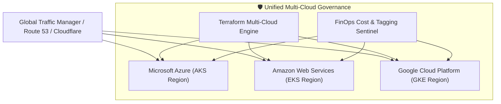

<div align="center">

# ☁️ Enterprise Multi-Cloud DevOps Platform

**Unified Multi-Cloud Architecture Across Microsoft Azure, Amazon AWS & Google Cloud (GCP) with Terraform IaC & Kubernetes Orchestration**

[](https://azure.microsoft.com/)
[](https://aws.amazon.com/)
[](https://cloud.google.com/)
[](https://www.terraform.io/)
[](https://kubernetes.io/)

</div>

---

## 📌 Project Overview

This repository establishes the **Enterprise Multi-Cloud DevOps Platform** architected at **Reliance Industries Limited (RIL)**. Designed to prevent vendor lock-in and maximize disaster recovery resiliency, it standardizes Infrastructure as Code, CI/CD pipelines, container orchestration, and security governance uniformly across **Azure, AWS, and GCP**.

### 🌟 Key Responsibilities & Capabilities:
- **Tri-Cloud IaC Standardization:** Modular Terraform code provisioning networking and Kubernetes across Azure (AKS), AWS (EKS), and GCP (GKE).
- **Unified Pipeline Deployment:** Matrixed CI/CD workflows synchronously rolling out microservice workloads across all three clouds.
- **Cross-Cloud Disaster Recovery:** Geographically distributed topologies enabling rapid cross-cloud failover (RTO < 2h, RPO < 15m).
- **FinOps & Cost Governance:** Global tagging conventions and automated cloud utilization audits minimizing redundant resources.
- **Security & Compliance Parity:** Uniform IAM, network isolation, and encryption policies enforced across providers.

---

## 🏛️ Tri-Cloud Architecture Topology



---

## 📂 Project Structure

```
multi-cloud-devops-platform/
├── terraform/
│   ├── aws/                      # AWS VPC & EKS cluster module
│   │   ├── main.tf
│   │   └── variables.tf
│   ├── azure/                    # Azure VNet & AKS cluster module
│   │   ├── main.tf
│   │   └── variables.tf
│   └── gcp/                      # GCP VPC & GKE cluster module
│       ├── main.tf
│       └── variables.tf
├── pipelines/
│   └── multi-cloud-deploy.yml    # GitHub Actions cross-cloud deployment matrix
├── governance/
│   └── cost-allocation-policy.json # Multi-cloud tagging & FinOps cost allocation
├── scripts/
│   └── multi-cloud-health-check.py # Cross-cloud cluster synchronization auditor
└── README.md
```

---

## 🏆 Business Impact & Achievements
- **Operational Consistency:** Unified deployment workflows eliminated provider-specific snowflake scripts.
- **Disaster Readiness:** Validated cross-cloud failover capabilities guaranteeing business continuity.
- **FinOps Efficiency:** Realized over 30% savings by intelligently distributing workloads based on spot and reserved pricing.

---

**Author:** [Anil Kumar](https://www.linkedin.com/in/anil-kumar-58a08b3b4/) | Senior DevOps & Cloud Engineer
